# ⚡ Awesome Scheduled SQL Task Orchestration 🚀

**A Curated Guide to Cloud SaaS Platforms & High-Performance Open-Source Workflow Engines for Scheduled SQL Transformations, Declarative Data Pipelines & Asset Lineage.**

[🌐 Overview](#-sector-overview--market-dynamics) • [☁️ SaaS Products](#-saas--hosted-platforms) • [🐙 Open-Source Projects](#-open-source-github-projects) • [🤝 Contributing](#-how-to-contribute) • [📄 Disclaimer](#-disclaimer)

---

## 📌 Executive Summary & Key Highlights 💡

Modern analytics engineering and data platform architecture increasingly revolve around **Scheduled SQL Task Orchestration**. Whether executing transformations directly inside cloud data warehouses (Snowflake, BigQuery, Databricks, ClickHouse) or orchestrating hybrid multi-system pipelines, orchestration engines transform fragile cron scripts into resilient, observable, and dependency-aware Directed Acyclic Graphs (DAGs).

* **🎯 Core Objectives**: Dependency graphs, automatic backfilling, declarative DAG definitions, asset lineage, retry strategies, and real-time observability.
* **⚙️ Paradigm Shifts**: The migration from imperative Python-only DAGs (Airflow 1.x legacy) towards declarative YAML-first orchestration (Kestra), software-defined data assets (Dagster), and automated SQL dependency analysis (SQLMesh, Optimus).

---

## 📊 Sector Overview & Market Dynamics 📈

The global data pipeline and workflow orchestration market is estimated at **$9.2 Billion in 2026**, expanding rapidly at a **~21.4% CAGR** propelled by warehouse-centric data transformation (ELT) and enterprise data mesh initiatives. 

The sector is **moderately fragmented**: mega-cap hyperscalers (such as Amazon Web Services and Snowflake) capture baseline cloud-native spend, while specialized pure-play orchestrators (Astronomer/Airflow, Prefect, Dagster, and dbt Labs) fiercely compete with high developer mindshare and distinct workflow philosophies (task-based vs. asset-based vs. declarative DAGs).

---

## 📑 Table of Contents 🗂️

- [📊 Sector Overview & Market Dynamics](#-sector-overview--market-dynamics)
- [☁️ SaaS / Hosted Platforms](#-saas--hosted-platforms)
  - [🏢 Enterprise SaaS Comparison Table](#-enterprise-saas-comparison-table)
- [🐙 Open-Source GitHub Projects](#-open-source-github-projects)
  - [⭐ Open-Source Ranked by GitHub_Stars](#-open-source-ranked-by-github-stars)
  - [🔍 Deep-Dive by Orchestration Philosophy](#-deep-dive-by-orchestration-philosophy)
- [🤝 How to Contribute](#-how-to-contribute)
- [💖 Support & Sponsorship](#-support--sponsorship-)
- [📈 Star History](#-star-history)
- [🛡️ Disclaimer & Licensing](#️-disclaimer--licensing)

---

## ☁️ SaaS / Hosted Platforms 🏢

The following hosted data pipeline and workflow orchestration platforms provide fully managed execution, high-availability control planes, integrated enterprise governance, and zero-infrastructure overhead.

### 🏢 Enterprise SaaS Comparison Table

Sorted descending by company size (Valuation / Market Capitalization / Annual Revenue):

| Platform / Vendor | Company Size / Valuation | Starting Paid Tier Pricing | Free Tier / Trial Allowance | Primary Architecture & Key SQL Capabilities |
| :--- | :--- | :--- | :--- | :--- |
| **[AWS Step Functions](https://aws.amazon.com/step-functions/)** | **~$2.1T+ Market Cap** *(Amazon)* | **$1.00 per 100,000 state transitions** (Express: $1.00/1M transitions + $0.00001667/GB-s) | **4,000 free state transitions per month forever** (Standard workflows) | Serverless JSON/ASL visual state machine engine; native integration with Athena, Redshift, Glue, and Lambda. |
| **[Snowflake Tasks](https://docs.snowflake.com/en/user-guide/tasks-intro)** | **~$45B+ Market Cap** | **Standard Edition: ~$2.00 to $3.00 per Snowflake Credit** (Warehouse compute consumed) | **30-day free trial with $400 of free usage credits** | Native serverless and warehouse-backed SQL task scheduling; task graph DAGs (`AFTER`), CRON triggers, and Streams CDC. |
| **[dbt Cloud](https://www.getdbt.com/)** | **~$4.2B Valuation** | **Developer: $100/seat/month** | **Free forever plan for 1 developer seat** (unlimited SQL model runs, 1 scheduled job) | SQL-first transformation DAGs based on `ref()` and `source()`, automatic model compilation, documentation, and lineage graphs. |
| **[Temporal Cloud](https://temporal.io/)** | **~$1.5B+ Valuation** | **$25/month minimum commitment** ($4.20 per million Actions consumed) | **30-day free trial with $200 in free usage credits** | Durable code execution engine; automatic persistence and recovery for long-running workflows and microservices. |
| **[Apache Airflow (Astronomer)](https://www.astronomer.io/)** | **~$1.2B+ Valuation** | **Developer: Starts at $0.05/hour (~$36/month)** or Astro Starter tiers | **14-day free trial with $300 in free cloud credits** | The leading enterprise-managed Apache Airflow platform; Python-native DAG orchestration with massive provider ecosystems. |
| **[Dagster Cloud](https://dagster.io/)** | **~$450M Valuation** | **Pro: Starts at $100/month** (includes base orchestrator compute + usage allowance) | **Free forever Developer plan: 1 user, up to 250 task runs per month** (plus 30-day unlimited trial) | Software-defined asset orchestration; data contracts, built-in SQL table lineage, and declarative freshness policies. |
| **[Prefect Cloud](https://www.prefect.io/)** | **~$350M Valuation** | **Pro: Starts at $40/month per seat** (includes 50,000 flow runs/month) | **Free forever plan: Up to 3 users and 20,000 workspace task runs per month** | Pythonic function-based orchestration (`@flow`, `@task`), dynamic execution graphs, and modern developer ergonomics. |
| **[Kestra Cloud](https://kestra.io/)** | **~$50M+ Valuation** | **Team Edition: Starts at $199/month** | **30-day free trial with full Enterprise features** (plus 100% free open-source core forever) | Declarative YAML-first workflow orchestration; supports polyglot tasks (SQL, Python, Docker, dbt) with 2,300+ plugins. |
| **[Mage.ai](https://www.mage.ai/)** | **~$35M Valuation** | **Pro: Starts at $50/month per workspace** | **14-day free trial with full workspace capabilities** (plus 100% free open-source edition forever) | Interactive hybrid notebook and code-based DAG builder; seamless SQL block execution, data validation, and scheduling. |
| **[Shipyard](https://www.shipyardapp.com/)** | **~$15M Valuation** | **Team: Starts at $50/month** (includes additional runtime hours and multi-user access) | **Free Developer tier: 10 hours of pipeline runtime per month forever** (no credit card required) | Low-code/no-code visual workflow orchestrator; plug-and-play blueprints for Snowflake, BigQuery, Postgres, and dbt. |

---

## 🐙 Open-Source GitHub Projects 🛠️

Open-source workflow engines empower platform engineering teams to eliminate vendor lock-in, maintain complete sovereignty over sensitive database credentials, and customize schedulers to exact infrastructure needs.

### ⭐ Open-Source Ranked by GitHub_Stars

Below is the verified ranking of top open-source SQL and data workflow orchestration projects, sorted descending by GitHub Stars_Counts (live social badges link directly to the respective stargazers page):

| Project | GitHub_Stars | Primary Language | License | Key Orchestration Strengths |
| :--- | :---: | :---: | :---: | :--- |
| **[Apache Airflow](https://github.com/apache/airflow)** |  | Python | Apache-2.0 | The industry standard for complex Python-defined task DAGs; thousands of database hooks and operators. |
| **[Kestra](https://github.com/kestra-io/kestra)** |  | Java | Apache-2.0 | High-throughput declarative YAML-based orchestrator; language-agnostic plugins for SQL, Python, containers, and event triggers. |
| **[Temporal](https://github.com/temporalio/temporal)** |  | Go | MIT | Resilient, durable workflow-as-code runtime ensuring fault-tolerant execution across distributed systems and databases. |
| **[Prefect](https://github.com/PrefectHQ/prefect)** |  | Python | Apache-2.0 | Decorator-driven Python orchestration; resilient retries, dynamic task generation, and flexible hybrid agents. |
| **[Windmill](https://github.com/windmill-labs/windmill)** |  | Rust | AGPL-3.0 | Ultra-fast developer engine and DAG runner for SQL, Python, and TypeScript with automatic UI generation. |
| **[Argo Workflows](https://github.com/argoproj/argo-workflows)** |  | Go | Apache-2.0 | Container-native workflow engine for Kubernetes; orchestrates parallel steps, batch SQL tasks, and compute-intensive steps. |
| **[Dagster](https://github.com/dagster-io/dagster)** |  | Python | Apache-2.0 | Data-aware orchestrator emphasizing software-defined assets (SDAs), declarative data contracts, and table-level lineage. |
| **[dbt Core](https://github.com/dbt-labs/dbt-core)** |  | Python | Apache-2.0 | The de facto SQL modeling and transformation framework with built-in DAG dependency resolution and testing. |
| **[Mage](https://github.com/mage-ai/mage-ai)** |  | Python | Apache-2.0 | Modern notebook-style data pipeline engine; modular code/SQL blocks, instant local testing, and git synchronization. |
| **[Flyte](https://github.com/flyteorg/flyte)** |  | Go / Python | Apache-2.0 | Kubernetes-native scalable workflow automation platform for mission-critical data pipelines and distributed analytics. |
| **[SQLMesh](https://github.com/SQLMesh/sqlmesh)** |  | Python | Apache-2.0 | Next-generation data transformation and orchestration tool with automatic virtual data environments, SQL column-level lineage, and zero-downtime deployments. |
| **[Optimus](https://github.com/raystack/optimus)** |  | Go | Apache-2.0 | SQL-first workflow orchestrator that parses queries automatically to compile DAG dependencies and manage warehouse jobs. |

---

### 🔍 Deep-Dive by Orchestration Philosophy 🧠

#### 1. 🐍 Python-Native Orchestrators
* **[Apache Airflow](https://github.com/apache/airflow)**: The battle-tested incumbent. Offers rich operators for AWS, Azure, GCP, Postgres, Snowflake, and BigQuery. Python DAGs define schedules, sensor dependencies, and concurrency pools.
* **[Dagster](https://github.com/dagster-io/dagster)**: Replaces traditional task-oriented thinking with data-oriented asset graphs. Ideal for tracking how data tables change and declaring data freshness policies.
* **[Prefect](https://github.com/PrefectHQ/prefect)**: Focuses on lightweight, idiomatic Python. Turns existing functions into orchestratable workflows with minimal boilerplate.
* **[Mage](https://github.com/mage-ai/mage-ai)**: Bridges interactive development and production scheduling with an interactive UI and notebook blocks.

#### 2. 📝 Declarative & Multi-Language Orchestrators
* **[Kestra](https://github.com/kestra-io/kestra)**: Defines workflows entirely in declarative YAML. Executes SQL statements directly against warehouses without embedding SQL inside custom application binaries.
* **[SQLMesh](https://github.com/SQLMesh/sqlmesh)**: Combines declarative modeling with deep SQL semantic understanding. Automatically figures out incremental data partitions and handles backfills safely.
* **[Optimus (Raystack)](https://github.com/raystack/optimus)**: Auto-derives execution dependencies by parsing ASTs of SQL queries, eliminating manual DAG creation.

#### 3. ⚡ Cloud-Native, Durable & Micro-Schedulers
* **[Temporal](https://github.com/temporalio/temporal)**: Durable workflow execution ensuring that transient outages in databases or networks never leave a pipeline in an inconsistent state.
* **[Argo Workflows](https://github.com/argoproj/argo-workflows)**: Designed specifically for Kubernetes clusters, providing scalable containerized workflow execution.
* **[Flyte](https://github.com/flyteorg/flyte)**: Enterprise-scale pipeline automation with typed inputs/outputs and checkpointing.
* **[Pulse Scheduler](https://pypi.org/project/pulse-scheduler/)**: Single-binary, zero-configuration Python/SQLite task scheduler with an interactive drag-and-drop DAG canvas for lightweight SQL workflows.

---

## 🤝 How to Contribute 🌟

Contributions to improve this curated list are very welcome!

1. 🍴 **Fork the repository** on GitHub.
2. 🌿 **Create a dedicated branch**: `git checkout -b feature/add-orchestrator-tool`.
3. ✏️ **Add/edit your tool**: Ensure pricing details, free tier limits, Stars_Badges, and descriptions follow the existing format.
4. 🚀 **Submit a Pull Request** with a concise description of why the tool should be added.

---

## 💖 Support & Sponsorship ☕

Thank you for visiting and using this curated guide! If this list has saved you time, helped you evaluate your data orchestration stack, or inspired your platform architecture, please consider supporting the project:

- ⭐ **Star this repository** to help others discover it across GitHub.
- 🍴 **Fork it & contribute** your insights, tools, or updates via PRs.
- 📢 **Share it** with fellow data engineers, analytics engineers, and platform teams.
- ☕ **Buy me a coffee / Sponsor**: If you'd like to support ongoing curation and open-source maintenance, please consider backing on the [**GitHub Sponsors Dashboard**](https://github.com/sponsors/ishandutta2007). Your support is deeply appreciated!

---

## 📈 Star History

---

## 🛡️ Disclaimer & Licensing 📜

* 📖 This repository is a community-curated collection for educational and architectural evaluation purposes.
* 🔒 **Security Notice**: Orchestrators connecting to internal production data warehouses often manage privileged credentials. Always follow best practices: enforce role-based access control (RBAC), utilize secret management vaults (e.g., HashiCorp Vault, AWS Secrets Manager), and configure minimum necessary database permissions.
* ⚖️ **License**: Distributed under the [MIT License](LICENSE).

---

**Made with ❤️ for Data Engineers, Analytics Architects, and Platform Teams.**  
*Star ⭐ this repository if you found it useful!*

